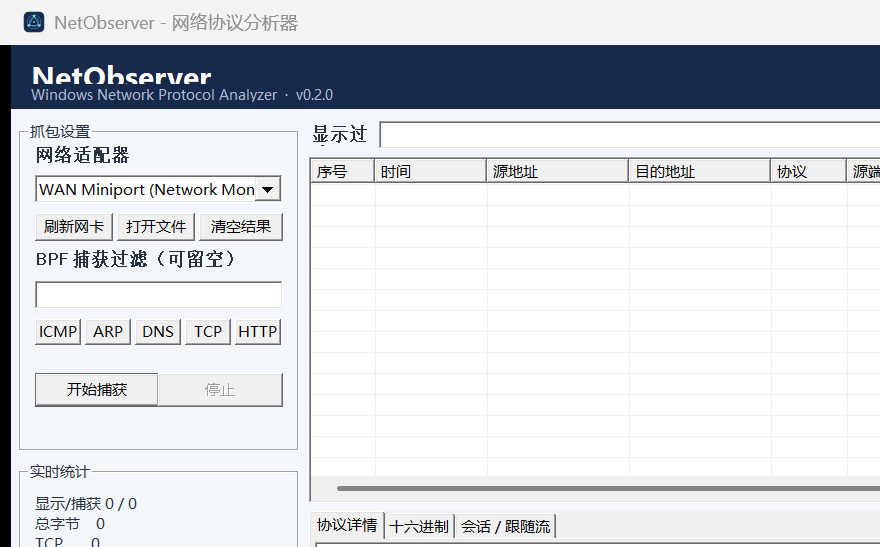

# NetObserver

NetObserver 是一个面向 Windows 的网络协议分析器实验项目，使用 C++17、Win32 GUI 和 Npcap 开发。




## 版本

当前版本：`0.2.0`

## 功能

- 枚举并选择 Windows 抓包网卡
- 混杂模式捕获和 BPF 过滤
- 捕获线程与界面线程分离
- 捕获过滤与捕获后显示过滤分离
- Ethernet、VLAN、IPv4、TCP、UDP、ARP、ICMP、IGMP 解析
- HTTP 和 FTP 基础应用层识别
- 数据包列表、协议字段、十六进制和统计信息
- DLT_EN10MB 与 DLT_NULL/DLT_LOOP 链路格式
- 每次捕获自动保存 pcap
- 打开已有 `.pcap` 和 `.pcapng` 文件
- 自动保存 pcapng，并可打开经典 pcap
- DNS、IPv6 和增强 HTTP 字段分析
- TCP 双向会话跟踪、乱序重组和 Follow Stream
- 会话流量统计、实时包速率和吞吐量
- 100,000 包 / 256 MB 的界面存储上限

## 系统要求

- Windows 10 或更高版本
- Npcap 运行库
- Visual Studio 2022 Build Tools 或 Visual Studio 2022
- CMake 3.20 或更高版本

抓包通常需要管理员权限。

## 构建

将 Npcap SDK 解压到 `third_party/npcap-sdk`，然后运行：

```powershell
.\scripts\build-vs-cmake.cmd
```

生成文件：

- `build\vs\Debug\NetObserver.exe`
- `build\vs\Debug\netobserver-cli.exe`
- `build\vs\Debug\netobserver-tests.exe`

也可以直接双击 `run-gui.cmd`，脚本会先构建再启动程序。

## 使用

1. 打开 `NetObserver.exe`。
2. 选择当前正在联网的物理网卡，例如 `Realtek Wireless LAN`。
3. “BPF 捕获过滤”默认为空，表示捕获全部数据包。需要减少捕获量时可填写
   `icmp`、`arp`、`udp port 53` 等 BPF 表达式。
4. 点击“开始捕获”。
5. 产生对应流量，然后点击“停止”。
6. 在“显示过滤”中输入条件并点击“应用过滤”，只改变已经捕获的数据包列表，
   不会重新抓包，也不会丢弃已捕获的数据。

点击“打开文件”可以加载已有的 `.pcap` 或 `.pcapng` 文件，加载完成后同样可以
使用显示过滤器。也可以把文件作为启动参数：

```powershell
.\build\vs\Release\NetObserver.exe .\captures\example.pcapng
```

命令行离线分析：

```powershell
.\build\vs\Release\netobserver-cli.exe --read .\captures\example.pcapng
```

选择一个 TCP 数据包后，点击“跟随当前流”可以查看双向 TCP 重组内容。
“仅此会话”会自动生成对应的地址和端口显示过滤器。

程序会在当前工作目录的 `captures` 文件夹中保存 `.pcap` 文件。

显示过滤示例：

```text
icmp
tcp and tcp.port == 80
ip.addr == 192.168.1.10
udp.port == 53 or dns
http or arp
frame.len > 100
not arp
```

支持的显示过滤字段包括 `ip.addr`、`ip.src`、`ip.dst`、`tcp.port`、
`udp.port`、`port`、`frame.len` 和 `protocol`，并支持 `and`、`or`、
`not` 与括号。

此外还支持 `ipv6.addr`、`ipv6.src`、`ipv6.dst`、`dns.id`、
`dns.qry.name`、`http.request.method`、`http.request.uri`、`http.host`
和 `http.response.code`。

## 已知限制

- 当前主要解析 IPv4，IPv6 仅显示基础信息。
- HTTP/FTP 分析基于单个数据包，尚未实现完整 TCP 流重组。
- IP 分片暂不重组。
- 实时捕获默认保存为 pcapng，同时兼容经典 pcap 文件。
- TCP Follow Stream 仅保留每个方向最多 1 MB。
- 公开版本发布前仍需补充更多畸形包测试和完整的隐私说明。

## License

This project is licensed under the MIT License.

Copyright (c) 2026 7he_var.

Npcap is a separate third-party dependency and is not covered by this
project's MIT License. See [THIRD_PARTY_NOTICES.md](THIRD_PARTY_NOTICES.md).

